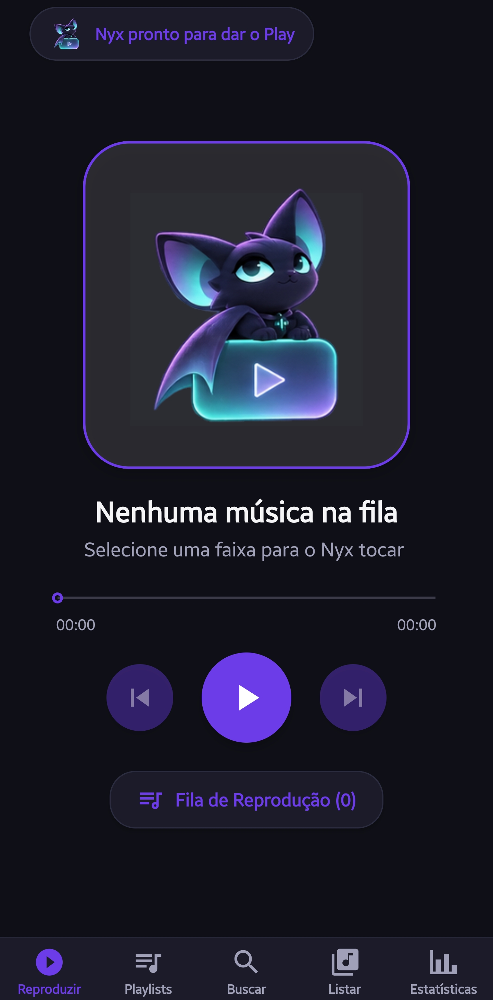
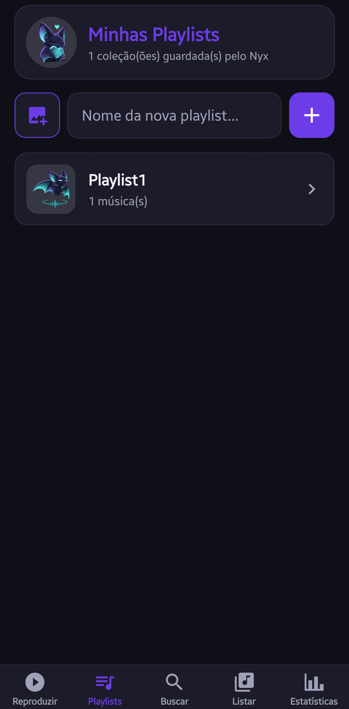
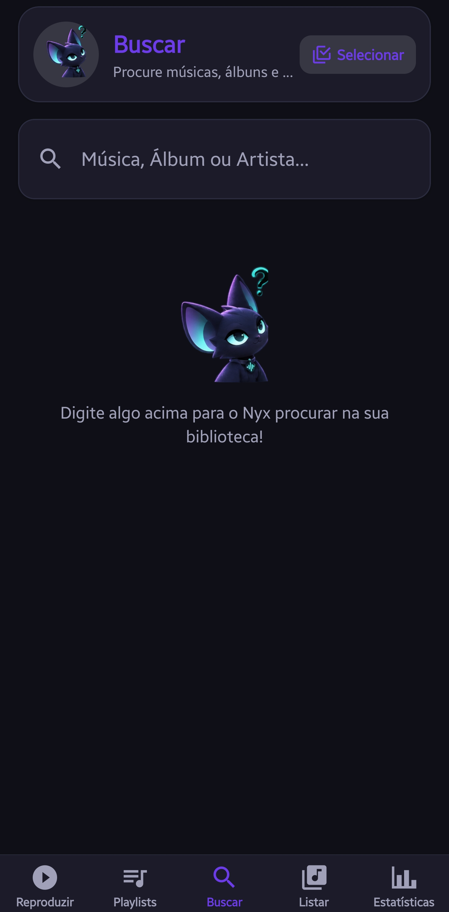
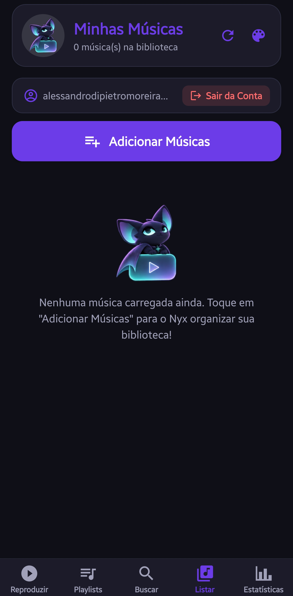
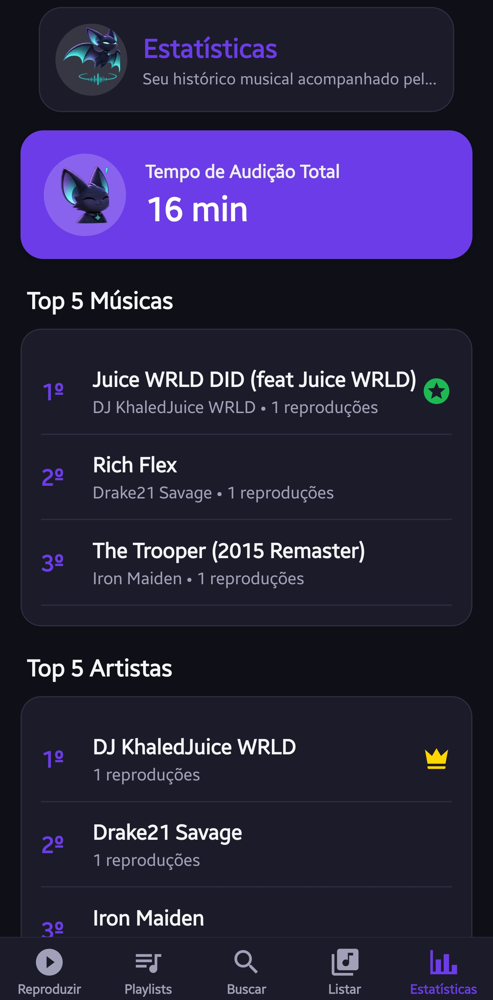

# 🎵 MusicPlayer (Nyx)

<p align="center">
  
  
  
  
  
</p>

> Projeto da disciplina **CCP150 — Desenvolvimento de Aplicativos Móveis** (Centro Universitário FEI — Prof. Isaac).

---

## 📌 Visão Geral e Requisitos

* **Ideia e Motivação:** Reprodutores locais comuns não sincronizam playlists nem histórico de audição entre sessões, enquanto apps de streaming exigem assinatura e conexão constante. O **MusicPlayer (Nyx)** adota uma arquitetura híbrida (*Offline-First* + Nuvem): os arquivos `.mp3` permanecem locais no celular, enquanto playlists e estatísticas sincronizam em tempo real no **Firebase**.
* **Objetivo:** Importar arquivos `.mp3` locais no Android e Web, extrair tags ID3v2 e capas diretamente dos bytes do arquivo, gerenciar filas por gestos e persistir dados na nuvem com feedback visual e tátil.
* **Requisitos Atendidos:**
  * **Telas:** **8 telas funcionais principais** (além de `Login` e `Cadastro`, somando **10 telas**): *Reproduzir*, *Playlists*, *Detalhes da Playlist*, *Buscar*, *Detalhes do Álbum*, *Detalhes do Artista*, *Listar Músicas* e *Estatísticas*.
  * **Navegação:** `Stack.Navigator` raiz + `BottomTabNavigator` (5 abas) com `NativeStackNavigator` aninhado em *Playlists* e *Buscar*.
  * **Imagens e UX:** 9 expressões do mascote Nyx (`./assets/mascote*.png`), capas extraídas de MP3, pré-visualizações da galeria, cartões alinhados, **Modo Claro/Escuro**, **6 paletas de cores** e diálogos de confirmação.
  * **Banco de Dados (CRUD Completo):** Sincronização em tempo real no **Firebase Realtime Database** sob `users/{uid}/`.
  * **Atuadores:** Motor de **Vibração** (`Vibration` API em controles, fila e troca de poses) e **Áudio** (`expo-audio` em primeiro e segundo plano com controle na notificação/tela de bloqueio).

---

## 🛠️ Tecnologias Utilizadas

| Tecnologia / Biblioteca | Aplicação no Projeto |
| :--- | :--- |
| **React Native & Expo (`~58.0`)** | Base Android/Web com `Animated` (`AnimarEntrada`, pulso da capa, `BannerMascote`), `PanResponder` (reordenação da fila e fechamento por gesto), `Vibration`, `FlatList` e `Modal`. |
| **`@react-navigation/*`** | Navegação combinada de `BottomTabNavigator` (5 abas principais) e `NativeStackNavigator` (*Login/Cadastro*, detalhes de *Playlist*, *Álbum* e *Artista*), usando `useIsFocused` nas transições. |
| **`expo-audio`** | `useAudioPlayer`, `useAudioPlayerStatus` e `setAudioModeAsync` para play/pause, `seekTo`, reprodução em segundo plano (`shouldPlayInBackground`), modo silencioso e metadados/capa na tela de bloqueio. |
| **`@react-native-community/slider`** | Barra de progresso em `ReproduzirItens.js` com estado dedicado durante o arraste (`scrubbing`) e *debounce* no `seekTo`. |
| **`expo-document-picker` & `image-picker`** | Importação múltipla de arquivos `.mp3` (`ListarItens.js`) e seleção de fotos da galeria para capas de playlists (`Playlists.js`). |
| **`expo-file-system`** | Leitura binária local em `ExtrairTags.js` e gravação de capas temporárias em `Paths.cache` (`file://`) para exibição na notificação Android. |
| **`@react-native-async-storage/async-storage`** | Cache offline da biblioteca (sem Base64 pesado para evitar estouro de armazenamento), preferências de tema/cor, fila pendente de estatísticas offline e sessão de login no celular. |
| **`firebase` (Auth & Realtime Database)** | `initializeAuth` + `getReactNativePersistence` mantém a sessão salva; `firebase/compat/database` sincroniza playlists e estatísticas em `users/{uid}`. |
| **`@expo/vector-icons`, `status-bar`, `font`** | Ícones `MaterialCommunityIcons`, adaptação da barra do sistema ao tema e carregamento de fontes nativas. |
| **Parser ID3v2 / MPEG (`ExtrairTags.js`)** | Leitor binário em JS puro (`Uint8Array`) para extrair título, artista, álbum, capa (`APIC`/`PIC`) e duração real de MP3s CBR e VBR (`Xing`/`Info` ou média de frames). |

---

## ✨ Funcionalidades e Banco de Dados

### Funcionalidades das Telas
* **Reproduzir (`ReproduzirItens.js`):** Capa animada ou mascote Nyx interativo, slider fluido, fila arrastável via `PanResponder` e controles em segundo plano com capa na notificação.
* **Playlists e Detalhes (`Playlists.js`, `TelaPlaylist.js`):** Criação com proteção contra duplicidade, `ModalEscolherCapa` (galeria ou 12 presets), renomeação preservando faixas, reprodução aleatória e detecção de faixas ausentes offline.
* **Buscar, Álbum e Artista (`BuscarItens.js`, `TelaAlbum.js`, `TelaArtista.js`):** Busca unificada por músicas, álbuns e artistas, telas de detalhes agrupadas e seleção múltipla em lote.
* **Biblioteca e Estatísticas (`ListarItens.js`, `Estatisticas.js`):** Importação múltipla de `.mp3`, reprocessamento de tags ID3, personalização de tema/cor, logout, Tempo de Audição Total e Top 5 Músicas/Artistas/Álbuns com sincronização offline em lote (`estatisticas_pendentes`).
* **Acesso (`Login.js`, `Cadastro.js`):** Autenticação com validação e sessão persistente.

### CRUD no Firebase Realtime Database (`users/{uid}/`)
* **Create (`.set()`, `.push()`, `ServerValue.increment`):** Criação de playlists, inclusão individual/em lote de músicas e registro incremental de audições concluídas.
* **Read (`.on('value')`, `.once('value')`):** Escuta em tempo real de playlists e estatísticas (com `.off()` ao sair) e leitura pontual ao renomear playlists.
* **Update (`.set()`, `.update()`):** Troca de capa, renomeação segura de playlist e atualizações atômicas em lote de estatísticas.
* **Delete (`.remove()`, atualização nula):** Exclusão unitária/em lote de faixas e exclusão completa da playlist com confirmação.

---

## 🎥 Demonstração

▶️ **[Assista ao vídeo explicativo no YouTube](https://www.youtube.com/watch?v=-DrfFa8kz2U)**

[](https://www.youtube.com/watch?v=-DrfFa8kz2U)

| Reproduzir | Playlists | Buscar | Biblioteca (Listar) | Estatísticas |
| :---: | :---: | :---: | :---: | :---: |
|  |  |  |  |  |

---

## 🚀 Instalação, Firebase e Execução

**Pré-requisitos:** Node.js 18+, npm, Git, Expo Go (Android/iOS) ou navegador, e uma conta no [Firebase Console](https://console.firebase.google.com/).

1. **Clone e instale as dependências:**
   ```bash
   git clone https://github.com/AlessandroMoreira19/MusicPlayer.git
   cd MusicPlayer
   npm install
   ```

2. **Crie seu projeto no Firebase e configure o `.env`:**
   * No [Firebase Console](https://console.firebase.google.com/), crie um projeto, ative **Authentication (E-mail/senha)** e crie um **Realtime Database**.
   * Em **Realtime Database → Regras**, aplique o isolamento por usuário autenticado:
     ```json
     {
       "rules": {
         "users": {
           "$uid": {
             ".read": "auth != null && auth.uid === $uid",
             ".write": "auth != null && auth.uid === $uid"
           }
         }
       }
     }
     ```
   * Registre um **App Web** nas configurações do projeto Firebase e copie `.env.example` para `.env` (`Copy-Item .env.example .env` no Windows PowerShell ou `cp .env.example .env` no macOS/Linux). Preencha as 7 chaves `EXPO_PUBLIC_FIREBASE_*` com os dados do SDK do app Web; as instruções também estão comentadas no `.env.example`.
   * **Importante:** nunca substitua os valores do `.env.example` pelos valores reais nem envie `.env` ao GitHub. As variáveis `EXPO_PUBLIC_*` são incorporadas ao aplicativo e podem ser vistas por quem o instala; não são segredos. Proteja o Firebase com regras de segurança adequadas e nunca coloque senhas administrativas, chaves privadas ou credenciais de servidor nessas variáveis.

3. **Execute o aplicativo:**
   ```bash
   npx expo start -c
   ```
   Escaneie o QR Code no **Expo Go** ou pressione `w` para abrir na Web. Se alterar o `.env`, reinicie o Expo para carregar as novas variáveis. *(Para build de APK Android via EAS, utilize `apk-build/GERAR_APK.bat` com as mesmas variáveis `EXPO_PUBLIC_FIREBASE_*` configuradas no `expo.dev`.)*

---

## 📂 Estrutura e Aprendizados

```text
MusicPlayer/
├── App.js             # Contexto global, navegação (Tabs + Stacks), modais e sync Firebase
├── config/config.js   # Firebase via .env, persistência de Auth, paletas, mascote e helpers
├── components/        # Telas (Reproduzir, Playlists, Buscar, Listar, Estatísticas...) + ExtrairTags.js
├── docs/prints/       # Capturas de tela do aplicativo
├── assets/            # Ícones, splash e 9 poses do mascote Nyx
└── .env.example       # Modelo e guia de configuração Firebase (.env real ignorado no Git)
```

* **Aprendizados:** Integração entre React Context e pilhas de navegação aninhadas; persistência híbrida *Offline-First* filtrando Base64 do `AsyncStorage` e sincronizando estatísticas em lote; leitura binária `Uint8Array` de tags ID3v2 e frames MPEG; áudio em segundo plano, gestos com `PanResponder` e isolamento de credenciais com `.env` + regras de segurança no Firebase.
* **Próximos Passos:** Botões de **Próxima/Anterior** na notificação Android, ferramenta para reencontrar `.mp3` movidos de pasta, recuperação de senha (`sendPasswordResetEmail`) e modos de repetição (*Repeat One/All*).
